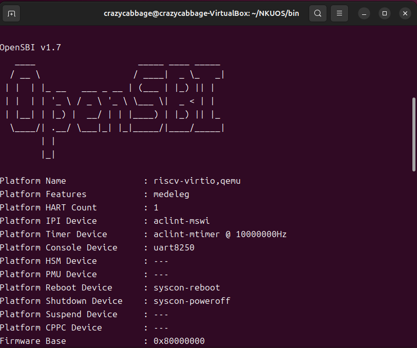
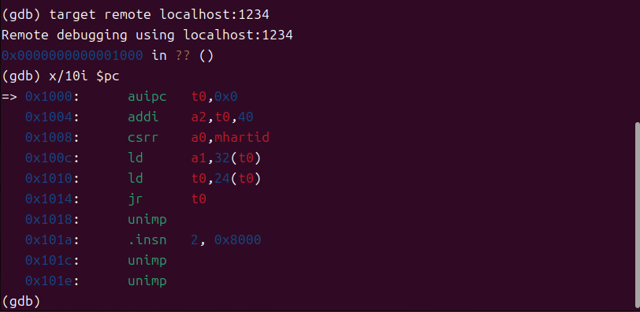
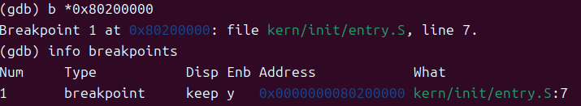

# 操作系统实验报告

## 实验基本信息
**实验名称**：Lab1: 最小可执行内核
**小组成员**：2213633_翟玉坤、2312149_李朝顺
**完成日期**：2026/10/11

### 小组分工
**练习分工**
| 成员 | 负责的练习/模块 |
| 2213633_翟玉坤 | 完成最小OS可执行内核的运行测试，并通过GDB进行调试和内核启动过程追踪 |
| 2312149_李朝顺 | 完成实验报告撰写与结果记录 |

**实验报告分工**
| 成员 | 负责的实验报告部分 |
| 2213633_翟玉坤 | 实验内容与实现、测试与验证（GDB调试记录） |
| 2312149_李朝顺 | 实验整体逻辑分析、练习解答、实验总结与收获 |

## 一、实验目的

本实验的主要目的是：

1. 了解如何进行交叉编译生成可执行文件来生成内核镜像
2. 了解如何使用 OpenSBI 作为 bootloader 加载内核镜像，并使用 Qemu 进行模拟
3. 了解如何使用GDB对OS内核启动的过程进行调试

## 二、实验环境
你们使用的 AI 工具：
*   学号1-姓名1（翟玉坤）：DeepSeek Harnes | DeepSeek-V4-Flash
*   学号2-姓名2（李朝顺）：DeepSeek Harnes | DeepSeek-V4-Flash

## 三、实验整体逻辑分析
### 2.1 本章节的逻辑主线
本章节作为整个课程的首个实验，主要是通过QEMU来运行这个最小的可执行OS内核，并对其上电启动过程进行分析，来帮助了解与分析操作系统的引导与初始化过程。

### 2.2 功能的逐步实现
1.  首先完成基本环境的搭建，比如安装好QEMU，下载好RISC-V交叉编译工具等等。
2.  接着通过交叉编译工具编译源代码为elf可执行文件。
3.  之后通过命令行启动QEMU来运行这个最小的可执行内核，检查一切是否如期运行。
4.  通过GDB来进行断点调试，以便于我们可以追踪这个内核从上电到开始执行内核指令的完整过程。

## 四、实验内容与实现

### 练习：【练习一、二】

负责人：[2312149_李朝顺]

练习一：理解内核启动中的程序内核操作

· la sp, bootstacktop 完成的操作与目的：
  · 功能：把符号 bootstacktop 的地址加载到栈指针 sp，相当于将内核预留启动栈的最高地址设为当前栈顶，其中la的含义是将某个地址加载进寄存器，sp是栈指针，bootstacktop指向内核启动栈的栈顶。
  · 目的：建立内核执行所需的初始栈环境（RISC-V栈向下增长），保证后续进入C代码（函数调用、保存返回地址、局部变量）有合法且对齐的栈空间。
· tail kern_init 完成的操作与目的：
  · 功能：以尾调用形式无返回地跳转到C函数 kern_init，直接把控制权交给 kern_init且不再保存返回地址。
  · 目的：进入内核的主体初始化流程（设置子系统、控制台输出等）且不保留无意义的入口栈帧，减少开销并表明该入口代码不期望返回。

练习二：使用GDB验证启动流程
调试过程与结果观察：

调试过程：
1. 首先启动QEMU，通过-S来挂起等待GDB，之后启动GDB，通过x/10i $pc可以看到加电后最初执行的几条指令以及其位于的地址。
2. 在GDB中设置断点 b *0x80200000，并查看寄存器与汇编。

结果观察：
观察到 QEMU 启动后，PC 初始值为 0x1000，即 OpenSBI 固件的入口。执行 x/10i $pc 查看固件指令：首先 auipc t0, 0x0，然后 addi a2, t0, 40，csrr a0, mhartid 读取硬件线程ID，最后通过 ld t0, 24(t0) 和 jr t0 跳转到 0x80200000（内核入口）。

回答练习二问题：

· 1. RISC-V硬件加电后最初执行的几条指令位于什么地址？
  答：位于 0x1000，这是 OpenSBI 固件的起始地址。
· 2. 它们主要完成了哪些功能？
  答：这几条指令是 OpenSBI 固件的一部分，主要完成环境准备与参数设置，获取硬件线程ID (mhartid)，并最终通过 jr t0 跳转到内核的加载地址 0x80200000，将控制权移交给操作系统内核。

五、测试与验证

测试截图：

六、实验总结与收获

对操作系统的理解

1. 列出你们认为本实验中重要的知识点，以及与对应的OS原理中的知识点，并简要说明二者的含义、关系和差异。
   · 知识点：Bootloader（引导加载程序）与OS内核的交接。
   · OS原理：计算机加电后，BIOS/UEFI（或OpenSBI）先运行，负责初始化硬件，然后将OS内核加载到内存特定地址并跳转执行。本实验中使用OpenSBI充当了Bootloader的角色，跳转到0x80200000运行最小内核。
2. 列出你们认为OS原理中很重要，但在本实验中没有对应的知识点。
   · 进程管理、虚拟内存管理、文件系统、中断处理机制等。

AI 协作开发的经验
[写出你们在AI协作过程中实际收获的经验或者感悟]

· 本次实验并没有任何新代码编写相关内容，AI在本次实验的主要作用是帮助正确搭建内核运行环境，了解需要的linux命令，辅助分析GDB调试代码等等，
我感觉AI对于基本前置工作这方面帮助很大（能帮助快速搞清很多烦人的错误，比如动不动缺少xxx依赖等等），我觉得AI如果用的好，能省下来很多前置的麻烦事，
并且通过AI辅助对代码分析，也能加快自己对这些代码是如何运行的理解.