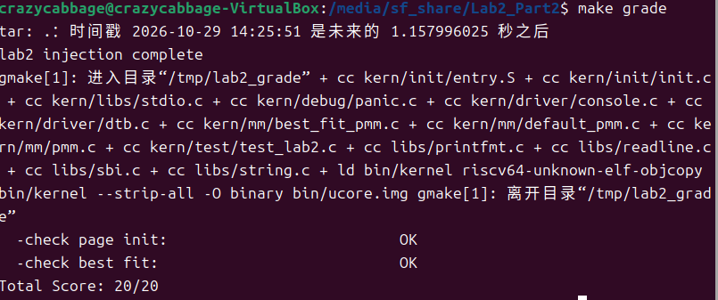
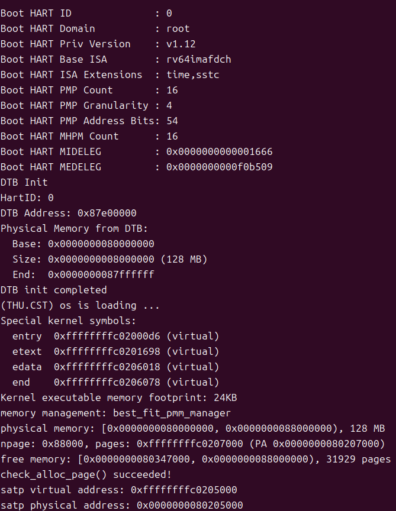
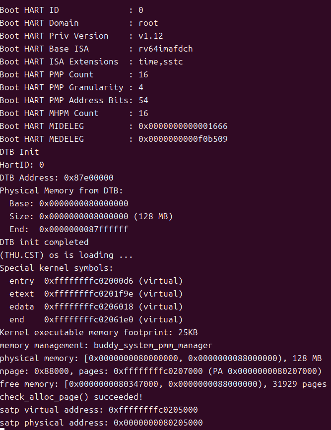

# 操作系统实验报告

## 实验基本信息

** 实验名称 ** | Lab2: 物理内存和页表
** 小组成员 ** | 2213633-翟玉坤、2312149-李朝顺
** 完成日期 ** | 2026/10/26

### 小组分工
**练习分工**
| 成员 | 负责的练习/模块 |成员 负责的练习/模块
| 2213633-翟玉坤 | 完成物理内存探测和分配的实现 |
| 2312149-李朝顺 | 完成实验报告撰写与结果记录 |

**实验报告分工**
| 成员 | 负责的实验报告部分 |
| 2213633-翟玉坤 | 实验内容与实现、测试与验证、提示词迭代与代码运行情况记录 |
| 2312149-李朝顺 | 实验整体逻辑分析、练习解答、实验总结与收获 |

## 一、实验目的

本实验的主要目的是：

1. 理解页表的建立和使用方法
2. 理解物理内存的管理方法
3. 理解页面分配算法

## 二、实验环境
你们使用的 AI 工具：
*   2213633-翟玉坤：DeepSeek Harnes | DeepSeek-V4.1-Flash
*   2312149-李朝顺：DeepSeek Harnes | DeepSeek-V4.1-Flash

## 三、实验整体逻辑分析
### 2.1 本章节的逻辑主线
本次实验的重点在于如何在给出的半成品源码的基础上实现一个初步的物理内存管理，并通过页表映射来进行虚拟内存到物理内存之间的映射。

### 2.2 功能的逐步实现
本次实验共分为几个需要额外实现的模块，包括 page_init 用于实现物理内存探测与页描述符初始化功能，实现 Best-Fit 连续物理内存分配算法，并通过 buddy system 伙伴系统分配算法将系统中的可用存储空间划分为存储块 (Block) 来进行管理。

## 四、实验内容与实现

### 功能模块：物理内存探测与页描述符初始化功能

**负责人：** [2213633-翟玉坤]

#### 模块功能描述

**需要实现/修改的函数：**

```c
static void page_init(void)
```

**功能说明：**

根据设备树提供的物理内存信息建立可管理物理页的描述符布局，并把排除 OpenSBI、内核镜像和描述符数组占用空间后的完整空闲页面交给当前pmm_manager管理，为后续页面分配提供正确的初始状态。

#### 最终提示词

以下是经过迭代优化后，最终成功实现该功能的提示词：

````markdown

请在pmm.c中实现这个还未编写的page_init函数，这个函数无参数，无返回值，其根据设备树提供的物理内存信息建立可管理物理页的描述符布局，并把排除 OpenSBI、内核镜像和描述符数组占用空间后的完整空闲页面交给当前pmm_manager管理，为后续页面分配提供正确的初始状态

## 操作要求：
本次请修改实际pmm.c文件，在pmm.c文件中有这么一行：//lab2 function1 YOUR CODE 在这行代码下面插入这个函数代码实现，不要改动其它的代码

## 预期成功返回结果：
- 成功返回时应正确设置va_pa_offset、npage和pages
- 输出探测到的物理内存范围
- 完成当前物理内存管理器初始空闲区的注册

## 函数实现要求
- 必须区分虚拟地址、物理地址、物理页号和Page描述符地址，正确处理可管理上界和页面对齐，并确保内核及描述符数组不会进入空闲区；
- 设备树信息无效时应终止初始化，没有可用完整页面时不得调用init_memmap()。

## 可使用函数和其它内容
- 实现过程中可以使用以下函数：
get_memory_base()
get_memory_size()
panic()
cprintf()
init_memmap()
pa2page()

以及可以使用链接符号end、struct Page及相关全局变量，并使用框架提供的内存上界、地址转换、页面对齐和页面状态宏完成初始化。

````

#### 实现迭代过程

本模块的实现经历了 [1] 次迭代，过程如下：

---

##### 第一次迭代

**最终结果：**
本部分需要在下一部分的Best-Fit部分完成后才可顺利编译运行并知道实际结果。

---

### Challenge：[硬件的可用物理内存范围的获取方法]

**负责人：** [2312149-李朝顺]

如果 OS 无法提前知道当前硬件的可用物理内存范围，请问你有何办法让 OS 获取可用物理内存范围？

- OS 需要由 bootloader 或固件把内存布局“告诉”它。 对于RISC-V ，可以通过通过设备树传递。流程为：
QEMU 生成设备树 → OpenSBI 把 DTB 地址传给内核 → 内核解析 DTB 里的 /memory 节点。

---

### 功能模块：物理内存分配功能

**负责人：** [2213633-翟玉坤]

#### 模块功能描述

**需要实现/修改的函数：**

```c
static void init_pmm_manager(void)

static void best_fit_init(void)
static void best_fit_insert_free_block(struct Page *base)
static void best_fit_init_memmap(struct Page *base, size_t n)
static struct Page * best_fit_alloc_pages(size_t n)
static void best_fit_free_pages(struct Page *base, size_t n)
static size_t best_fit_nr_free_pages(void)
```

**功能说明：**
此部分为OS物理内存分配的实现，除了原始代码的First-Fit之外，此部分还实现了Best-Fit和Buddy System两种物理内存分配算法。

### 任务1：[理解first-fit 连续物理内存分配算法]

**负责人：** [2312149-李朝顺]

结合kern/mm/default_pmm.c中的相关代码，用自己的话简要说明 First-Fit 分配器如何初始化空闲页、分配连续物理页、回收页面并合并相邻空闲块，以及原有的first fit算法是否有进一步的改进空间？

- First-Fit通过default_init_memmap函数完成初始化空闲页，按地址将空闲页插入链表，之后通过default_alloc_pages取第一个大小合适的块，同时在块大小大于需求时切分多余的部分为新块，default_free_pages用于回收页面和合并相邻空闲块。
- 原有 First-Fit 每次分配都需要线性遍历链表。可引入分离空闲链表按块大小分类管理；或使用红黑树等平衡二叉树维护空闲块以优化时间复杂度。

---

### 任务2：[实现 Best-Fit 连续物理内存分配算法]

**负责人：** [2213633-翟玉坤]

#### 最终提示词

以下是经过迭代优化后，最终成功实现该功能的提示词：

````markdown

请在best_fit_pmm.c实现完整的 Best-Fit 物理内存管理模块，并在实现后将pmm.c的init_pmm_manager()中将当前物理内存管理器切换为best_fit_pmm_manager，以确保内核运行和检查的是 Best-Fit 实现。

## 操作要求：
- 本次请修改实际best_fit_pmm.c和pmm.c文件，在best_fit_pmm.c文件中有这么一行：//lab2 function2-2 YOUR CODE 在这行代码下面插入这个函数代码实现。
- 并修改实际pmm.c文件，在pmm.c文件的init_pmm_manager()将default_pmm_manager换成best_fit_pmm_manager（两个定义分别位于两个不同的pmm模块的的头文件）。
- 其它的代码和文件不做任何改动。

## 预期成功返回结果：
- 可以正常通过测试即可。

## 实现要求
- 生成的实现必须符合测试函数使用的状态约定，不得修改两个测试函数。
- 时空复杂度无要求。

## 实现提示：
- best_fit_pmm.c只提供basic_check()和best_fit_check()两个测试函数，不提供具体管理函数的声明和best_fit_pmm_manager注册结构。
- 检查pmm.h中的struct pmm_manager，根据各成员的职责自行设计 Best-Fit 分配器的内部状态和相关管理函数，并定义best_fit_pmm_manager完成注册。

````

#### 实现迭代过程

本模块的实现经历了 [1] 次迭代，过程如下：

---

##### 第一次迭代

**最终结果：**
经过 [1] 次迭代，该模块最终：
- ✅ 编译通过
- ✅ 所有相关测试通过
- ✅ 功能符合预期

---

### 本 Best-Fit 算法是否有进一步的改进空间？

- 本算法实现可以通过分桶，大小树等方式把 O(B) 进一步优化为 O(log B) 或 O(1)。
- 可以通过边界标记让合并不再依赖地址排序。

### 任务3：[buddy system（伙伴系统）分配算法]

**负责人：** [2312149-李朝顺]

#### 最终提示词

以下是经过迭代优化后，最终成功实现该功能的提示词：

````markdown
# 提示词1
实现buddy system分配算法,把系统中的可用存储空间划分为存储块(Block)来进行管理, 每个存储块的大小必须是2的n次幂(Pow(2, n))。

## 操作要求：
- 本次请在lab2的mm文件夹中添加新文件来进行buddy system分配模块实现，需要重头实现，原始代码并没有对此提供前置代码和框架，并将实现后的模块接入内核。
- 无关的代码和文件不做任何修改。

## 实现要求：
- 算法的时空复杂度不做要求。

## 实现提示：
- 本模块实现需参考现有 ucore 物理内存管理框架进行设计。


# 提示词2
请在先前的buddy system实现的基础上设计相应的测试函数，以检验其实现是否正确。

## 操作要求：
- 请基于buddy system分配算法实现的上半部分的添加的模块代码文件buddy_system_pmm.c实现这个测试函数。
- 无关的代码和文件不做任何修改。

## 实现要求：
- 需要覆盖buddy system分配算法的核心行为（即检查存储块大小划分是否符合算法预期，如块的大小必须都是2的n次幂）和边界情况
- 算法的时空复杂度不做要求。
````

#### 实现迭代过程

本模块的实现经历了 [2] 次迭代，过程如下：

---

##### 第一次迭代

本次迭代完成了buddy system分配算法的实现，但仍需要下一部分的测试函数来检验正确性。

##### 第二次迭代

**最终结果：**
经过 [2] 次迭代，该模块最终：
- ✅ 编译通过
- ✅ 所有相关测试通过
- ✅ 功能符合预期

---

#### 测试函数说明

- 本测试函数把buddy system算法的正确性化成一组每次操作后都必须成立的不变量，然后在每个关键操作之后逐条验证。
- 检验核心部分包括块大小是否都是2的n次幂，buddy system的向下分裂行为，逐级合并。
- 边界条件包括超过全部空闲内存，请求过大。

## 五、测试与验证

**测试截图：**





## 六、实验总结与收获

### 对操作系统的理解

1. 列出你们认为本实验中重要的知识点，以及与对应的OS原理中的知识点，并简要说明二者的含义、关系和差异。

· 知识点：物理内存管理与页表映射（虚拟地址到物理地址的转换）。
· OS原理对应知识点：内存管理单元（MMU）、多级页表、TLB（快表）。
· 含义与关系：本实验通过手动构建页表（Page Directory 和 Page Table），将虚拟地址映射到物理地址，这是OS内存管理的基础。实验中的连续内存分配和伙伴系统是物理内存管理的具体算法实现。
· 差异：实验中的页表映射相对基础，而现代OS原理中，为了节省空间，通常采用多级页表，并且会使用TLB来加速地址转换。此外，实验侧重于物理内存的分配和映射建立，而理论课会深入探讨页面置换算法以及缺页中断的完整处理流程。

2. 列出你们认为OS原理中很重要，但在本实验中没对应的知识点。

· 页面置换算法（Page Replacement Algorithms）：如LRU、FIFO、Clock算法。本实验假设物理内存足够，主要关注分配和映射的建立，没有涉及物理内存不足时如何将页面换出到磁盘的机制。
· 缺页异常处理（Page Fault Handling）的完整流程：实验中映射建立后即可直接访问，没有模拟访问未映射虚拟地址时触发缺页中断，以及OS如何分配新页并更新页表的完整上下文切换过程。
· 写时复制（Copy-on-Write, COW）：进程创建（fork）时的高级内存优化机制，实验中未涉及。

### AI 协作开发的经验

· 这次是第一次借助AI来进行本次实验代码内容的实现，和AI一起完成项目代码的开发并不是一件那么容易的事，在这个过程里，如果对预期实现目标和AI写的东西没有足够的理解，就会遇到很多的问题，也无法正确判断AI写的正确与否，
总而言之，理解自己要做什么是很重要的，只有做到这点，才能正确指导AI完成项目，并从中对OS有更深的理解。