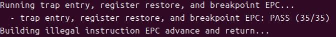
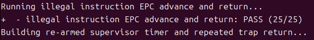
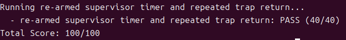

# 操作系统实验报告

## 实验基本信息

** 实验名称 ** | Lab3: 物理内存和页表
** 小组成员 ** | 2213633-翟玉坤、2312149-李朝顺
** 完成日期 ** | 2026/11/7

### 小组分工
**练习分工**
| 成员 | 负责的练习/模块 |成员 负责的练习/模块
| 2213633-翟玉坤 | 完成中断处理机制实现 |
| 2312149-李朝顺 | 完成实验报告撰写与结果记录 |

**实验报告分工**
| 成员 | 负责的实验报告部分 |
| 2213633-翟玉坤 | 实验内容与实现、测试与验证、提示词迭代与代码运行情况记录 |
| 2312149-李朝顺 | 实验整体逻辑分析、练习解答、实验总结与收获 |

## 一、实验目的

本实验的主要目的是：

1. 了解riscv 的中断相关知识
2. 了解中断前后如何进行上下文环境的保存与恢复
3. 了解处理最简单的断点中断和时钟中断

## 二、实验环境
你们使用的 AI 工具：
*   2213633-翟玉坤：DeepSeek Harness | DeepSeek-V4.1-Flash
*   2312149-李朝顺：DeepSeek Harness | DeepSeek-V4.1-Flash

## 三、实验整体逻辑分析
### 2.1 本章节的逻辑主线
本次实验围绕如何在riscv中实现中断处理，其中一个核心概念是Trap frame，在整个过程中，我们需要完成Trap的上下文恢复及入口，同时完成对中断和异常的处理并返回恢复原本执行，让这个内核能够完整处理trap。
对于Trap frame,其为一个struct结构体，包含以下几个变量：
- uintptr_t status;  在触发trap前S态的状态。
- uintptr_t epc;  保存触发trap时的原代码运行位置，用于后续处理完成后返回原代码运行位置继续其运行。
- uintptr_t badvaddr;  保存出错地址。
- uintptr_t cause;  trap原因的编码，在后续的trap.c中需要借助它的值来判断这是一个中断还是异常。

### 2.2 功能的逐步实现
本次实验分为两部分，首先我们需要在trapentry.S汇编代码中完成Trap的上下文管理模块，需要完成的功能部分分别用于恢复原代码执行状态以及将Trap frame传进C语言的中断异常处理代码。
第二部分是完成这个C语言的中断异常处理，两个函数分别用于处理中断和异常。

## 四、实验内容与实现

### 功能模块：Trap 上下文恢复与 Trap 入口功能

**负责人：** [2312149-李朝顺]

#### 模块功能描述

**需要实现/修改的函数：**

```asm
RESTORE_ALL
__alltraps
```

**功能说明：**

RESTORE_ALL负责从Trap frame中恢复原程序的执行状态，__alltraps负责将Trap frame传入C语言trap.c中断异常处理代码中的void trap以进行后续的中断异常处理。

#### 最终提示词

以下是经过迭代优化后，最终成功实现该功能的提示词：

````markdown

请在Lab3目录下的源代码trapentry.S中实现未完成的RESTORE_ALL 和 __alltraps，完成一个完整的Trap 上下文恢复与 Trap 入口功能。

## 操作要求:
- 本次请修改实际trapentry.S文件，在这个文件里的#lab3 function1 YOUR CODE下方插入对应的代码实现。
- 其它的代码和文件不做任何改动。

## 实现要求：
- 保持Trap frame 布局、上下文保存与恢复、函数调用约定、Trap 返回状态之间的一致性，本次实现的RESTORE_ALL必须与已经提供的 SAVE_ALL 保持对应关系。
- __alltraps 需要保证当前 Trap frame 的地址能够按照 RISC-V 调用约定作为 trap() 的参数传递，同时不能破坏后续恢复上下文所需要的信息。
- Trap 发生以后，系统应能够通过 __alltraps 建立完整的 Trap frame，并将其作为 struct trapframe * 传递给 void trap(struct trapframe *tf);
- 不得修改 SAVE_ALL、struct trapframe 和 trap() 的函数签名。

## 实现提示：
- SAVE_ALL 中对 x2(sp) 的处理方式与其他通用寄存器并不完全相同。
- 本模块主要依赖 struct trapframe、trap()、已经提供的 SAVE_ALL、__alltraps、__trapret、RESTORE_ALL 以及 RISC-V 函数调用约定和特权级 Trap 返回机制。

````

#### 实现迭代过程

本模块的实现经历了 [1] 次迭代，过程如下：

---

##### 第一次迭代

**最终结果：**
本部分需要在下一部分的部分完成后才可顺利编译运行并知道实际结果。

---

### 功能模块：中断与异常处理功能

**负责人：** [2213633-翟玉坤]

#### 模块功能描述

**需要实现/修改的函数：**

```c
void interrupt_handler(struct trapframe *tf)
void exception_handler(struct trapframe *tf)
```

**功能说明：**
interrupt_handler和exception_handler分别用于中断和异常的处理，需要区分不同的中断和异常，并输出相应的提示，以及对特定类型（例如时钟中断）进行进一步处理。

#### 最终提示词

以下是经过迭代优化后，最终成功实现该功能的提示词：

````markdown

请在Lab3目录下的源代码trap.c中实现 void interrupt_handler(struct trapframe *tf)和 void exception_handler(struct trapframe *tf)

## 操作要求:
- 本次请修改实际trap.c文件，在这个文件里的#lab3 function2 YOUR CODE下方插入对应的代码实现。
- 其它的代码和文件不做任何改动。

## 实现要求：
- interrupt_handler 负责处理中断其中时钟中断需要完成下一次时钟事件设置、时钟计数、统计信息输出以及达到规定次数后的系统关机，其他类型的中断只需要完成基本的类型区分和相应提示输出。若中断无法识别则通过已有的 print_trapframe 输出完整 Trap frame 以辅助调试。
- exception_handler 负责处理实验要求的异常，其中非法指令异常和断点异常需要输出规定格式的信息，并根据对应指令的长度正确更新 tf->epc，使 Trap 返回以后不会重复执行已经触发异常的指令；其他未要求具体处理的异常则使用已有的 print_trapframe 处理。
- 不得修改函数签名，也不得修改 trap.c 中规定以外的其他函数。

## 实现提示：
- 这个模块主要依赖 struct trapframe、trap_dispatch()、interrupt_handler()、exception_handler()、print_trapframe()、clock_set_next_event()、ticks、TICK_NUM、SHUTDOWN_AFTER、IRQ_S_TIMER、CAUSE_ILLEGAL_INSTRUCTION、CAUSE_BREAKPOINT 以及 libs/sbi.h 中提供的关机相关接口。
- 不同异常对应的指令长度可能不同，因此不能假定所有异常都使用相同的 epc 偏移量。

````

#### 实现迭代过程

本模块的实现经历了 [1] 次迭代，过程如下：

---

##### 第一次迭代

**最终结果：**
经过 [1] 次迭代，该模块最终：
- ✅ 编译通过
- ✅ 所有相关测试通过
- ✅ 功能符合预期

---

## 五、测试与验证

**测试截图：**





## 六、实验总结与收获

### 对操作系统的理解

1. 列出你们认为本实验中重要的知识点，以及与对应的OS原理中的知识点，并简要说明二者的含义、关系和差异。
本实验重要知识点：
  RISC-V Trap 机制：包括 trapframe 结构体的作用（保存/恢复寄存器现场）。
  Trap 的上下文切换：汇编代码 _alltraps（作为入口保存现场）和 RESTORE_ALL（恢复现场）的编写。
  中断与异常的区分及处理：C语言中 interrupt_handler（处理中断）和 exception_handler（处理异常）的具体实现。
对应的OS原理知识点：
  中断与异常处理机制：操作系统如何响应硬件或软件事件。
  上下文切换与现场保护：在进入内核态前后，保存和恢复CPU寄存器状态以保证程序正确执行。
  特权级切换：用户态与内核态之间的转换。
二者的含义、关系和差异：
  含义：OS原理知识点是抽象的、通用的计算机系统理论；本实验知识点是RISC-V架构下具体的代码实现。
  关系：实验是原理的具体落地。例如，OS原理中的“现场保护”，在实验中具体化为将寄存器压入栈中形成 trapframe；“中断服务程序”，在实验中体现为调用 interrupt_handler 函数。
  差异：OS原理侧重宏观的设计思想，而本实验侧重于微观的硬件架构细节。


2. 列出你们认为OS原理中很重要，但在本实验中没对应的知识点。
进程调度算法：本实验虽然处理了时钟中断，但只是进行简单的处理，并没有在中断返回前触发操作系统的调度器进行时间片轮转或进程切换。
复杂的缺页异常处理：虽然实验报告标题提及了“物理内存和页表”，但本次实验主要内容聚焦于Trap机制。OS原理中极其重要的虚拟内存到物理内存的映射、页面置换算法等在代码逻辑中未完全体现。
中断嵌套与并发控制：本实验处理的是最简单的中断，未深入涉及高优先级中断打断低优先级中断的嵌套机制，也未涉及多核环境下中断处理的同步锁（如自旋锁）机制。
系统调用：系统调用是用户态主动陷入内核态的异常，OS原理中通常与Trap机制结合紧密，但本次实验主要聚焦于被动中断，未完整实现一个系统调用流程。


### AI 协作开发的经验

· 在经过上一次实验后，这一次对于AI协助开发这件事有了一定的经验和更多的理解，总的来说完成本次实验并不算困难，但是在每一次协作中，不断打磨如何写好一个提示词，让AI编写的代码质量能够更好，
结构思路更加清晰，依然是一件很有意义的事情。