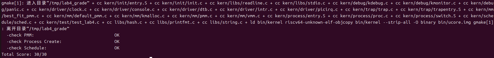

# 操作系统实验报告

## 实验基本信息

** 实验名称 ** | Lab4: 进程管理
** 小组成员 ** | 2213633-翟玉坤、2312149-李朝顺
** 完成日期 ** | 2026/11/22

### 小组分工
**练习分工**
| 成员 | 负责的练习/模块 |成员 负责的练习/模块
| 2213633-翟玉坤 | 完成进程创建调度等功能模块实现 |
| 2312149-李朝顺 | 完成实验报告撰写与结果记录 |

**实验报告分工**
| 成员 | 负责的实验报告部分 |
| 2213633-翟玉坤 | 实验内容与实现、测试与验证、提示词迭代与代码运行情况记录 |
| 2312149-李朝顺 | 实验整体逻辑分析、练习解答、实验总结与收获 |

## 一、实验目的

本实验的主要目的是：

1. 了解虚拟内存管理的基本结构，掌握虚拟内存的组织与管理方式
2. 了解内核线程创建/执行的管理过程
3. 了解内核线程的切换和基本调度过程

## 二、实验环境
你们使用的 AI 工具：
*   2213633-翟玉坤：DeepSeek Harness | DeepSeek-V4.1-Flash
*   2312149-李朝顺：DeepSeek Harness | DeepSeek-V4.1-Flash

## 三、实验整体逻辑分析
### 2.1 本章节的逻辑主线
本章节流程为：实现虚拟内存页操作->进程创建初始化->进程调度，从对虚拟内存的映射管理，再到如何实现进程的创建，并在之后完成对于进程的调度等操作。

### 2.2 功能的逐步实现
本次实验分为三部分，首先我们需要实现一个基本的页表映射和维护模块，能够顺利建立/撤销页表映射，之后需要完成进程的创建与初始化,最后实现进程调度。

## 四、实验内容与实现

### 功能模块：虚拟内存页操作功能

**负责人：** [2312149-李朝顺]

#### 模块功能描述

**需要实现/修改的函数：**

```c
int page_insert(pde_t *pgdir, struct Page *page, uintptr_t la, uint32_t perm)
void page_remove(pde_t *pgdir, uintptr_t la)
```

**功能说明：**

本模块负责在现有多级页表框架上完成最基本的映射维护，其中page_insert 负责建立或更新映射，page_remove 负责删除映射。

#### 最终提示词

以下是经过迭代优化后，最终成功实现该功能的提示词：

````markdown

首先请完成第一个任务，在lab4的pmm.c文件里实现int page_insert(pde_t *pgdir, struct Page *page, uintptr_t la, uint32_t perm) 和 void page_remove(pde_t *pgdir, uintptr_t la)

## 操作要求：
- 本次请修改实际的pmm.c文件，在 //LAB4 function1 YOUR CODE 行下方插入代码实现。
- 无关的文件和代码不做任何改动。

## 实现要求：
- 保持页表项内容、物理页引用计数、TLB 状态三者同步，所有页表更新完成后都要考虑对应 TLB 失效的情况。
- 本模块对外只需要提供建立映射和撤销映射两个动作，page_insert 成功时应让指定线性地址稳定映射到目标物理页，并把权限位设置为调用者要求的状态；失败时应返回 -E_NO_MEM且不留下半完成映射。
page_remove 则应作为一个幂等删除接口存在，目标地址有映射时删除映射、无映射时安静返回，不把未映射地址当作异常情况。

## 实现提示：
- page_insert 不能简单覆盖旧项， page_remove 也不能假定目标地址一定存在有效映射。
- 这个模块主要依赖 get_pte()、pte_create()、pte2page()、page_ref_inc()、page_ref_dec()、set_page_ref()、alloc_page()、free_page()、tlb_invalidate()、flush_tlb() 等现成接口，
也依赖 pde_t、pte_t、struct Page、pages、boot_pgdir_va 以及页表权限位宏 PTE_V、PTE_U、PTE_W、PTE_R。
其中 get_pte() 负责定位目标页表项，后续两个函数则在此基础上完成映射建立和映射删除。

````

#### 实现迭代过程

本模块的实现经历了 [1] 次迭代，过程如下：

---

##### 第一次迭代

**最终结果：**
本部分需要在下一部分的部分完成后才可顺利编译运行并知道实际结果。

---

### 功能模块：进程创建及初始化功能

**负责人：** [2213633-翟玉坤]

#### 模块功能描述

**需要实现/修改的函数：**

```c
static struct proc_struct *alloc_proc(void)
void proc_init(void)
int kernel_thread(int (*fn)(void *), void *arg, uint32_t clone_flags)
int do_fork(uint32_t clone_flags, uintptr_t stack, struct trapframe *tf)
static void copy_thread(struct proc_struct *proc, uintptr_t esp, struct trapframe *tf)
static int copy_mm(uint32_t clone_flags, struct proc_struct *proc)
```

**功能说明：**
本模块负责完成进程的创建与初始化，
其中alloc_proc 负责得到一个干净的进程控制块，proc_init 负责把当前执行现场包装成 idleproc 并创建第一个真正的内核线程 initproc，kernel_thread 负责把函数入口和参数整理成线程首次运行所需的临时上下文，
do_fork 负责把这些信息和内核栈、PID、链表、状态位等资源真正组合成一个可运行实体，copy_thread 负责把 trapframe 和 context 安放到新线程自己的内核栈上， copy_mm 目前用于承担地址空间处理接口的占位作用

#### 最终提示词

以下是经过迭代优化后，最终成功实现该功能的提示词：

````markdown

现在请完成第二个任务。在lab4的proc.c文件里实现以下函数：
static struct proc_struct *alloc_proc(void)
void proc_init(void)
int kernel_thread(int (*fn)(void *), void *arg, uint32_t clone_flags)
int do_fork(uint32_t clone_flags, uintptr_t stack, struct trapframe *tf)
static void copy_thread(struct proc_struct *proc, uintptr_t esp, struct trapframe *tf)
static int copy_mm(uint32_t clone_flags, struct proc_struct *proc)

## 操作要求：
- 本次请修改实际的proc.c文件，在 //LAB4 function2 YOUR CODE 行下方插入代码实现。
- 无关的文件和代码不做任何改动。

## 实现要求：
- 本模块实现需保证系统里至少要存在 idleproc 和 initproc 两个关键线程，并且 initproc 需要能够在后续调度中被真正切换执行。
- alloc_proc 必须把 PCB 置于安全空白状态
- kernel_thread 与 copy_thread 必须配合 forkret、forkrets、__trapret 形成正确的首次运行链路，do_fork 必须正确处理失败清理、PID 分配、链表挂接和唤醒顺序。
- 当前阶段copy_mm 无需做真正的用户地址空间复制，但仍需要维持函数形态完整。
- 本模块需要提供"线程从哪里来、如何进入系统、如何第一次运行"的完整外部接口。
其中alloc_proc 应返回一个已完成基础字段初始化的 PCB，proc_init 执行后应保证进程管理全局结构、idleproc、current 和 initproc 都处于可用状态，
kernel_thread 应把普通函数包装成可创建线程的上下文并返回新线程 PID，do_fork 应返回新线程 PID 或负错误码，copy_thread 与 copy_mm 则作为内部辅助接口，分别负责首次运行现场和地址空间处理

## 实现提示：
- 这个模块主要依赖 struct proc_struct、struct context、struct trapframe、list_entry_t、proc_list、hash_list、idleproc、initproc、current、nr_process 等核心数据结构和全局变量，
也依赖 kmalloc()、kfree()、memset()、memcpy()、alloc_pages()、free_pages()、page2kva()、kva2page()、set_proc_name()、find_proc()、get_pid()、wakeup_proc()、
list_init()、list_add()、boot_pgdir_pa、bootstack、read_csr(sstatus)、SSTATUS_SPP、SSTATUS_SPIE、SSTATUS_SIE、kernel_thread_entry、forkret、forkrets 等已有接口与符号。

````

#### 实现迭代过程

本模块的实现经历了 [1] 次迭代，过程如下：

---

##### 第一次迭代

**最终结果：**
本部分需要在下一部分的部分完成后才可顺利编译运行并知道实际结果。

---

### 功能模块：进程调度

**负责人：** [2213633-翟玉坤]

#### 模块功能描述

**需要实现/修改的函数：**

```c
void cpu_idle(void)
void schedule(void)
void proc_run(struct proc_struct *proc)
```

```asm
void switch_to(struct context *from, struct context *to)
```

**功能说明：**
本模块负责把已经创建出来的内核线程真正交给 CPU 执行
cpu_idle 作为空闲线程的执行主体，持续等待调度需求；schedule 负责从进程链表中选出下一个可运行线程；
proc_run 负责在安全的临界区内切换当前线程、页表和执行现场；switch_to 则负责最底层的寄存器上下文保存与恢复。

#### 最终提示词

以下是经过迭代优化后，最终成功实现该功能的提示词：

````markdown

现在完成最后一部分任务，在lab4的proc.c，sched.c，switch.s文件里实现以下函数
void cpu_idle(void) proc.c
void schedule(void) sched.c
void proc_run(struct proc_struct *proc) proc.c
void switch_to(struct context *from, struct context *to) switch.s

## 操作要求：
- 本次请修改实际的上述提及的文件，在 //LAB4 function3 YOUR CODE 行下方插入代码实现。
- 无关的文件和代码不做任何改动。

## 实现要求：
- cpu_idle 应持续作为空闲循环存在，检测到需要重调度时调用 schedule，
schedule 应完成一次合法的调度选择并触发进程切换，
proc_run 应让目标线程成为当前运行线程并完成页表切换，
switch_to 则应根据两个 struct context 指针完成从旧线程到新线程的寄存器状态迁移。
- 切换过程必须保持原子性，schedule 和 proc_run 都需要在关键区域内避免被中断打断。

## 实现提示：
- 这个模块主要依赖 struct proc_struct、struct context、read_csr()、write_csr()、SATP_MODE_SV39、RISCV_PGSHIFT、boot_pgdir_pa、flush_tlb()、proc_list、current、idleproc、need_resched、
runs、PROC_RUNNABLE、local_intr_save()、local_intr_restore()、switch_to()、list_next()、le2proc() 以及 forkret、forkrets、__trapret 这一条首次运行恢复链路。
- riscv.h 中的 lsatp() 本次不可用，可以参照pmm.c的 enable_paging()。

````

#### 实现迭代过程

本模块的实现经历了 [1] 次迭代，过程如下：

---

##### 第一次迭代

**最终结果：**
经过 [1] 次迭代，该模块最终：
- ✅ 编译通过
- ✅ 所有相关测试通过
- ✅ 功能符合预期

---

### Challenge1：[开关中断]

**负责人：** [2312149-李朝顺]

#### 说明语句 local_intr_save(intr_flag); ... local_intr_restore(intr_flag); 是如何实现开关中断的。
- local_intr_save(intr_flag)：会读取当前 CPU 的sstatus寄存器中的SIE(Supervisor Interrupt Enable) 位。将该位的状态（0或1）保存到局部变量intr_flag中，然后通过写入操作清除SIE位，从而关闭中断。local_intr_restore(intr_flag)：会根据之前保存在intr_flag中的状态，重新设置sstatus寄存器的SIE位。如果之前是开启状态，则恢复开启中断。

---

### Challenge2：[深入理解不同分页模式的工作原理]

**负责人：** [2213633-翟玉坤]

#### get_pte() 函数位于 kern/mm/pmm.c，用于在页表中查找或创建页表项，从而实现对指定线性地址对应的物理页的访问和映射操作。这在操作系统的分页机制下，是虚拟内存与物理内存建立映射关系的关键基础。

##### get_pte() 函数中有两段形式类似的代码，结合 sv32、sv39、sv48 的异同，解释这两段代码为什么如此相像。
- 这两段代码作用是在逐级遍历多级页表。在不同模式下的级数虽然不同，但每一级页表的查找逻辑是完全相同的：
从虚拟地址中提取当前级别的 VPN索引->以该索引去当前页表页中查找对应的 PTE。->检查 PTE 的有效位：如果有效且不是叶子节点，取出 PTE 中保存的下一级页表物理基址，进入下一级；如果无效，则需进行相应处理。
由于每一级的查找步骤在算法逻辑上是高度一致的，因此代码呈现出明显的相似性或重复性。
##### 目前 get_pte() 函数将页表项查找和页表页分配合并在一个函数里，你认为这种写法好吗？有没有必要把两个功能拆开？
- 这种写法的好处是调用者极其方便，不需要关心页表页是否存在，直接调用就能拿到最终的 PTE 指针。问题是函数职责过重，不够单一。在某些场景下，比如或者处理缺页异常时，自动分配新的页表页会浪费内存或干扰现有的内存管理逻辑。
- 有必要拆开两个功能，例如这么做可以实现一个walk_page_range函数，单纯用于遍历获取 PTE，而alloc_page和page_insert负责具体的分配与挂载。从而使得逻辑更加清晰，控制更精细。

## 五、测试与验证

**测试截图：**



## 六、实验总结与收获

### 对操作系统的理解

1. 列出你们认为本实验中重要的知识点，以及与对应的OS原理中的知识点，并简要说明二者的含义、关系和差异。
虚拟内存与多级页表（OS原理：内存管理）：
含义与关系：OS 原理中强调虚拟地址到物理地址的转换、页表的作用（隔离、保护）。本实验中，我们通过page_insert实现映射，通过get_pte遍历页表，并在测试中发现修改pte_t权限位（读写执行）以保护内核代码段。这不仅是理论验证，更是动手实现了内存隔离的底层机制。
进程控制块 PCB（OS原理：进程描述与管理）：
含义与关系：理论中的进程状态机、PCB 概念在本实验中具象化为struct proc_struct（包含pid, state, context, kstack`等）。我们通过 alloc_proc初始化它，通过 proc_run修改它的状态，完美印证了PCB是进程存在的唯一标志。
上下文切换与调度（OS原理：CPU 调度）：
 含义与关系：理论上的切换开销（保存现场与恢复现场）在本实验中体现为switch_to汇编代码。我们将当前的寄存器（如ra, sp, s0~s11）存入旧进程的context，再从新进程的context中加载，实现了最基础的 Round-Robin 调度。

2. 列出你们认为OS原理中很重要，但在本实验中没对应的知识点。
文件系统 (File System)：本实验主要聚焦于内存与进程管理，并未涉及文件的打开、读写、inode 管理等概念。
复杂的进程同步与互斥：虽然提到了开关中断，但像信号量（Semaphore）、管程（Monitor）、死锁检测等更高级的同步机制在本实验中尚未深入实现（可能在后续 Lab 中）。
用户态与内核态的交界：本实验主要运行在内核态（idleproc和initproc），用户进程的具体实现、系统调用的完整流程（如通过ecall陷入内核）尚未深入展开。


### AI 协作开发的经验

· 经过几次实验到现在，对于AI agent的使用已经比较熟练了，但是在这个过程中，自己的理解是最重要的，只有自己真正理解这些内容才能更好地支持实现实验内容的顺利完成。